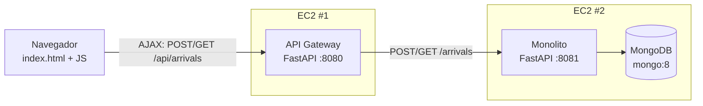

# Tarea 1: Lista de llegadas en AWS

En esta tarea se hace una aplicación para registrar quién llega y a qué hora. La persona escribe su nombre en un formulario, le da a Registrar y queda guardada en una base de datos junto con la hora de llegada. Debajo del formulario se ve la lista de todos los que han llegado.

El workshop se hizo en Python con FastAPI. La arquitectura es la misma que pide el enunciado: un front-end, un API Gateway, un monolito y MongoDB, todo en Docker y desplegado en dos instancias EC2. Para las dependencias usé [uv](https://docs.astral.sh/uv/).

## Cómo está armado



Son cuatro piezas:

- **Front-end** (`gateway/static/index.html`): una página con un campo para el nombre y un botón. Usa `fetch` para mandar el nombre al gateway sin recargar la página, y luego vuelve a pedir la lista para mostrarla actualizada. 
- **API Gateway** (`gateway/`): recibe las peticiones del navegador, valida que el nombre no venga vacío y que tenga máximo 100 caracteres (le quita los espacios de los lados), y se las pasa al monolito. Si el monolito está caído responde un `502` en vez de quedarse colgado.
- **Monolito** (`monolith/`): guarda el nombre con la hora del servidor en UTC (la hora no la manda el cliente, así nadie puede inventarse la hora de llegada) y devuelve la lista de la más reciente a la más antigua.
- **MongoDB**: corre en su propio contenedor con la imagen `mongo:8`. Los registros quedan en la colección `arrivals` de la base `arrivals`, y cada documento tiene `_id`, `name` y `timestamp`.

### Endpoints

Del gateway (lo que usa el navegador):

- `GET /` devuelve la página.
- `POST /api/arrivals` con un body como `{"name": "Pedro"}` registra una llegada.
- `GET /api/arrivals` devuelve la lista.

Del monolito (solo lo llama el gateway):

- `POST /arrivals` crea el registro y responde `{"id", "name", "timestamp"}`.
- `GET /arrivals` devuelve todos los registros.

FastAPI genera documentación automática, así que en `/docs` de cada servicio se pueden probar los endpoints desde el navegador.

### Archivos

```
.
├── compose.yaml            # para correr todo junto en local
├── gateway/
│   ├── app.py              # el API Gateway
│   ├── static/index.html   # el front-end
│   ├── pyproject.toml      # dependencias (uv)
│   ├── uv.lock
│   └── Dockerfile
└── monolith/
    ├── app.py              # el monolito, se conecta a MongoDB
    ├── pyproject.toml
    ├── uv.lock
    ├── Dockerfile
    └── compose.yaml        # monolito + MongoDB, es lo que uso en la EC2 #2
```

El `compose.yaml` de la raíz incluye el de `monolith/` y le agrega el gateway, así no repito la configuración de Mongo en dos lados.

### Configuración

Los servicios se configuran con variables de entorno:

- `MONOLITH_URL` (gateway): a dónde reenviar las peticiones. Por defecto `http://localhost:8081`.
- `MONGO_URI` (monolito): la conexión a Mongo. Por defecto `mongodb://localhost:27017/arrivals`.
- `DOCKERHUB_USER` (compose): mi usuario de Docker Hub, se usa para nombrar las imágenes. Si no se pone, queda `local`.

## Qué se necesita

- Python 3.12 y [uv](https://docs.astral.sh/uv/getting-started/installation/)
- Docker con Docker Compose v2
- Una cuenta de Docker Hub
- Una cuenta de AWS que pueda crear instancias EC2

## Correrlo en local con Docker Compose

Esta es la forma más fácil de probar todo. Levanta los tres contenedores en la misma red de Docker:

```bash
docker compose up -d --build
docker compose ps
```

Después entro a http://localhost:8080, escribo un nombre y le doy a Registrar.

También lo probé desde la terminal:

```bash
# registrar una llegada pasando por el gateway
curl -X POST http://localhost:8080/api/arrivals \
  -H "Content-Type: application/json" \
  -d '{"name": "Pedro"}'

# ver la lista
curl http://localhost:8080/api/arrivals

# un nombre vacío lo rechaza el gateway con 422
curl -i -X POST http://localhost:8080/api/arrivals \
  -H "Content-Type: application/json" \
  -d '{"name": "   "}'

# el monolito también responde directo
curl http://localhost:8081/arrivals
```

Para ver los logs y revisar que los datos sí quedaron en Mongo:

```bash
docker compose logs gateway
docker compose logs monolith
docker compose exec db mongosh arrivals --eval 'db.arrivals.find()'
```

Y para apagarlo:

```bash
docker compose down      # los datos se conservan en los volúmenes
docker compose down -v   # esto sí borra los datos de Mongo
```

## Correrlo sin Docker

Para desarrollar, se corren los servicios con uv y se deja solo Mongo en Docker, porque con `--reload` los cambios se ven al instante:

```bash
docker run -d --name mongo-dev -p 27017:27017 mongo:8

# terminal 1: el monolito en el puerto 8081
cd monolith
uv run uvicorn app:app --reload --port 8081

# terminal 2: el gateway en el puerto 8080
cd gateway
uv run uvicorn app:app --reload --port 8080
```

`uv run` crea el entorno virtual y le instala lo que está en `uv.lock` la primera vez. 

## Subir las imágenes a Docker Hub

```bash
docker login

export DOCKERHUB_USER=<dockerhub-user>
docker compose build          # crea <dockerhub-user>/arrivals-gateway:1.0 y <dockerhub-user>/arrivals-monolith:1.0
docker images | grep arrivals

docker push $DOCKERHUB_USER/arrivals-gateway:1.0
docker push $DOCKERHUB_USER/arrivals-monolith:1.0
```

Algo a tener en cuenta: la imagen queda construida para la arquitectura del computador donde se hizo el build. Este proyecto se construye en x86_64, así que en AWS se usan instancias x86_64 como `t3.micro` y no las ARM (`t4g`), porque ahí la imagen no arranca. Si se construye desde un Mac con Apple Silicon hay que agregar `--platform linux/amd64`, o usar `docker buildx build --platform linux/amd64,linux/arm64 --push`.

## Despliegue en AWS

Se usaron dos instancias EC2 con Amazon Linux 2023 en la misma VPC:

- **EC2 #1**: el API Gateway, que también sirve la página.
- **EC2 #2**: el monolito y MongoDB, cada uno en su contenedor.

### Security groups

Abrí solo lo necesario:

- EC2 #1: el 22 (SSH) solo desde mi IP, y el 8080 abierto a todos (`0.0.0.0/0`) porque ahí está la página.
- EC2 #2: el 22 solo desde mi IP, y el 8081 **solo desde el security group de la EC2 #1**. Así al monolito únicamente le puede hablar el gateway.

El puerto de Mongo (27017) no lo abrí en ningún lado. El `compose.yaml` del monolito ni siquiera lo publica, Mongo solo se ve dentro de la red de Docker.

### Instalar Docker (en las dos instancias)

```bash
sudo dnf update -y
sudo dnf install -y docker
sudo systemctl enable --now docker
sudo usermod -a -G docker ec2-user
exit   # hay que salir y volver a entrar para que tome el grupo docker
```

### EC2 #2: monolito y MongoDB

Amazon Linux 2023 no trae Docker Compose, así que toca instalarlo a mano:

```bash
sudo mkdir -p /usr/local/lib/docker/cli-plugins
sudo curl -SL https://github.com/docker/compose/releases/latest/download/docker-compose-linux-x86_64 \
  -o /usr/local/lib/docker/cli-plugins/docker-compose
sudo chmod +x /usr/local/lib/docker/cli-plugins/docker-compose
docker compose version
```

Desde mi computador copio el compose a la instancia:

```bash
scp -i <tu-llave>.pem monolith/compose.yaml ec2-user@<ec2-2-public-dns>:~/compose.yaml
```

Y ya en la instancia:

```bash
export DOCKERHUB_USER=<dockerhub-user>
docker compose pull
docker compose up -d --no-build
docker compose ps
docker compose logs monolith
curl http://localhost:8081/arrivals    # al principio responde []
```

De esta instancia necesito la **IP privada** para configurar el gateway. Sale en la consola de EC2 o con `hostname -I`.

### EC2 #1: API Gateway

```bash
docker pull <dockerhub-user>/arrivals-gateway:1.0

docker run -d \
  --name arrivals-gateway \
  --restart unless-stopped \
  -e MONOLITH_URL=http://<ip-privada-ec2-2>:8081 \
  -p 8080:8000 \
  <dockerhub-user>/arrivals-gateway:1.0

docker ps
docker logs arrivals-gateway
```

### Probar que funciona

En el navegador entro a `http://<ec2-1-public-dns>:8080`, registro varios nombres y reviso que aparezcan en la lista. Desde la terminal:

```bash
curl -X POST http://<ec2-1-public-dns>:8080/api/arrivals \
  -H "Content-Type: application/json" -d '{"name": "AWS"}'
curl http://<ec2-1-public-dns>:8080/api/arrivals
```

Si el gateway responde `502 Monolith unreachable`, casi siempre es una de dos cosas: la IP privada en `MONOLITH_URL` está mal, o el security group de la EC2 #2 no deja entrar el 8081 desde el de la EC2 #1.

## Al terminar

Hay que terminar las dos instancias EC2 para que AWS no siga cobrando.
